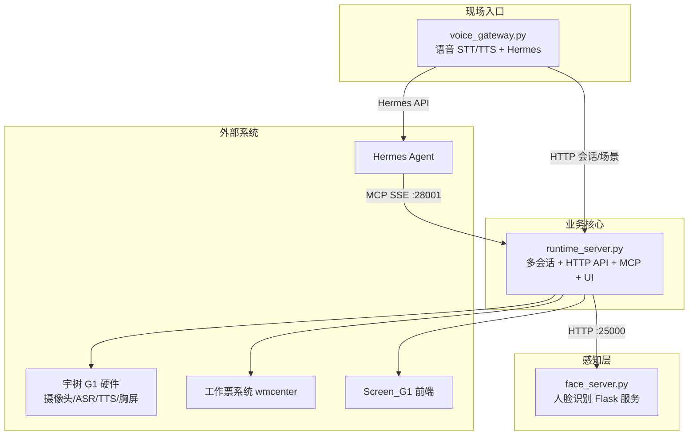

# FRD 项目结构分析

**FRD** 是一个面向**具身智能体 / 工作票安全管控**的 Python 终端系统，主要部署在**宇树 G1 机器人**上。核心场景包括：大厅迎宾、人脸识别签到、安全交底、开工会/收工会、人员进出场等，并通过 **Hermes Agent + MCP** 做语音编排。

---

## 总体架构：三服务拆分

项目已从单体拆成三个可独立部署的常驻服务：



| 服务 | 入口文件 | 默认端口 | 职责 |
|------|----------|----------|------|
| **Face** | `face_server.py` | 25000 | InsightFace 人脸识别、人脸库管理 |
| **Runtime** | `runtime_server.py` | 28000 (HTTP) / 28001 (MCP SSE) | 多会话业务、场景引擎、大厅迎宾、HTTP API、监控 UI |
| **Voice Gateway** | `voice_gateway.py` | — | 唯一语音指令入口：ASR/TTS + 连接 Hermes + 驱动 Runtime 会话 |

`main.py` 仅为兼容入口，默认启动 Runtime 并提示应使用三服务模式。

---

## 目录结构（按领域分层）

```
FRD/
├── face_server.py / runtime_server.py / voice_gateway.py  # 启动入口
├── bootstrap.py                                       # 旧引导（已迁移到 runtime/）
├── requirements.txt / requirements-g1.txt / requirements-dev.txt
│
├── config/           # 全局配置与环境变量
├── common/           # 跨模块公共能力（设备互斥、端口、文本清洗）
├── api/              # FastAPI 应用组装（路由挂载、UI 静态资源）
│
├── session/          # 多会话模型
│   ├── model/        # SessionContext / SessionState
│   ├── repository/   # SessionRegistry / BindingRegistry
│   ├── service/      # SessionService（会话生命周期）
│   └── api/          # REST + WebSocket 路由
│
├── runtime/          # Runtime 运行时逻辑
│   ├── bootstrap.py  # RuntimeContext 组装与启动
│   └── service/      # 单会话运行时、大厅值守、视频流、语音意图
│
├── recognition/      # 人脸识别子系统
│   ├── core/         # FaceModule、路径
│   ├── repository/   # RealSense 抓图、识别仓库
│   ├── server/       # Flask face_server 实现
│   └── service/      # 识别适配器
│
├── voice/            # 语音子系统
│   ├── repository/   # ASR 后端（G1 DDS / Vosk / FunASR）、TTS 工厂
│   └── service/      # 网关桥接、本地口令路由、Runtime 语音客户端
│
├── work/             # 业务域（工作票 + 场景）
│   ├── ticket/       # 工作票模型、Mock/API 仓库、TicketService
│   ├── scenario/     # 场景配置、引擎、执行器、前置检查、结果序列化
│   └── report/       # 安全报告上报
│
├── agent/            # Hermes 集成
│   ├── mcp/          # MCP 工具（frd_* / pms_*）、SSE 内嵌服务
│   └── repository/   # Hermes HTTP 客户端
│
├── ui/               # 展示层后端协议
│   ├── service/      # Screen_G1 WebSocket/HTTP 协议适配
│   └── static/       # 旧版 legacy UI（index.html）
│
├── hermes-skills/    # Hermes Agent 技能包（工作票安全场景路由 + 各子场景）
├── thirdparty/       # 外部 API 封装（wmcenter 工作票、FunASR）
├── HK_SDK/           # 海康摄像头 SDK（可选硬件）
├── deploy/           # systemd 用户服务、环境变量模板
├── docs/             # 部署文档（g1-deploy.md）
├── example/          # 硬件联调示例脚本
├── scripts/manual/   # 手动冒烟测试
├── tests/            # 单元测试 + API 测试
├── models/ images/ encodings/  # 人脸模型与数据资产
```

整体采用 **按领域分包 + 类 DDD 分层**（`model` / `repository` / `service` / `api`），模块边界清晰。

---

## 核心模块说明

### 1. 配置层 `config/`

- `settings.py`：集中管理环境变量（`FRD_*` 前缀），涵盖语音、UI、摄像头、大厅迎宾、视频流、Hermes、工作票源等。
- `scenarios.py`：预定义业务场景（`workLeaderSignIn`、`AQJD`、`KGH`、`SGH`、`workerEnter`、`workerExit` 等）。

### 2. 会话层 `session/`

多会话是 Runtime 的核心抽象：

- **SessionRegistry**：管理多个业务会话（如 `local`、`ball-a`）。
- **BindingRegistry**：Hermes 会话 `vg-<session>` ↔ Runtime 会话 `<session>` 的绑定。
- **SessionService**：创建/ensure 会话，为每个会话构建 **SessionRuntime**。
- **DeviceGateway**：进程内摄像头等设备互斥租约，避免多会话争抢硬件。

### 3. 运行时 `runtime/service/`

单会话内的业务编排：

| 文件 | 作用 |
|------|------|
| `session_runtime.py` | 单会话状态机：初始化工作票、跑场景、语音指令处理 |
| `lobby_watcher.py` | 大厅值守轮询（人脸检测 + 迎宾） |
| `lobby_identity.py` / `lobby_presence.py` | 身份锁定、在场/离开判定 |
| `video_stream.py` | 视频 JPEG 推流 |
| `voice_intent_handler.py` | 场景中语音意图（继续/结束/会议发言） |

### 4. 业务域 `work/`

- **ticket**：工作票加载（Mock / wmcenter API）、班组成员解析。
- **scenario**：场景引擎 → ScenarioRunner → 人脸识别执行 → 前置条件检查 → 结果上报。
- **report**：安全管控结果发布。

场景类型包括：单人签到、多人会议（含录音 `record_tts`）、人员进出场等。

### 5. 感知层 `recognition/` + `voice/`

- 识别：RealSense / 海康抓图 → HTTP 调 face_server → InsightFace 比对。
- 语音：工厂模式切换 ASR/TTS 后端（G1 内置 / Vosk / FunASR / pyttsx3）。
- `voice_gateway_bridge.py`：串联 STT → Hermes/本地路由 → Runtime → TTS 播报。

### 6. Agent 集成 `agent/`

- **inprocess_mcp.py**：Runtime 内嵌 MCP SSE 服务（`:28001`）。
- **runtime_tools.py**：暴露 `frd_create_session`、`frd_run_scenario`、`frd_push_voice_command` 等工具。
- **work_ticket_data_mcp.py**：工作票数据工具 `pms_load_ticket`、`pms_get_group_members`。
- **hermes_client.py**：与 Hermes Agent API 通信。

### 7. 展示层 `ui/` + Screen_G1

- 默认 `FRD_UI_BACKEND=screen_g1`，托管外部 Vue 构建产物（`Screen_G1/dist`）。
- WebSocket `/ws` 推送对话气泡、身份预览；HTTP `/api/v1/dialogs` 等对齐 Screen_G1 协议。
- 旧版 `ui/static/index.html` 可通过 `FRD_UI_BACKEND=legacy` 切回。

---

## 典型数据流

**语音驱动场景（Hybrid 模式，默认）：**

1. 用户说话 → `voice_gateway` ASR
2. 明确口令（如「签到」）→ 本地 `run_scenario`；模糊意图 → Hermes Agent
3. Hermes 调 MCP `frd_run_scenario` → Runtime 执行场景（人脸识别 + 上报）
4. TTS 经 gateway 从 G1 喇叭播报；Screen_G1 显示对话气泡

**大厅迎宾：**

1. Runtime `lobby_watcher` 轮询摄像头
2. 调 face_server 识别 → 触发问候 → WebSocket 推送到胸屏

---

## 技术栈

| 类别 | 技术 |
|------|------|
| Web 框架 | FastAPI（Runtime）、Flask（Face） |
| AI/视觉 | InsightFace、ONNX Runtime、OpenCV、RealSense |
| 语音 | 宇树 G1 DDS ASR/TTS、Vosk、FunASR、pyttsx3 |
| Agent | Hermes + MCP（SSE / stdio） |
| 部署 | systemd user services（`deploy/`） |
| 测试 | pytest（`tests/unit/`、`tests/api/`） |

---

## 部署与运维

- **G1 全量部署**：见 `docs/g1-deploy.md`
- **环境变量模板**：`deploy/frd.env.example`
- **systemd 服务**：`frd-face.service`、`frd-runtime.service`
- **Hermes 配置示例**：`hermes-skills/README.md`（MCP SSE + Skills 安装说明）
- **联调示例**：`example/g1_camera_test.py`、`g1_asr_listener.py`、`face_enroll.py`

---

## 设计特点小结

1. **三服务解耦**：识别、业务、语音可分机部署；Voice Gateway 是唯一语音入口。
2. **多会话平台**：一个 Runtime 支撑多个现场（多网关共享 MCP，通过 `hermes_session_id` 路由）。
3. **Hybrid 编排**：明确口令本地程序化，复杂意图交 Hermes，场景中「继续/结束」不经 Agent。
4. **硬件抽象**：摄像头/ASR/TTS 均可 Mock，便于无硬件开发联调（`FRD_HARDWARE_MOCK`）。
5. **场景驱动**：`config/scenarios.py` 声明式配置 + `ScenarioRunner` 统一执行流水线。

如果你想深入某一块（例如 MCP 工具列表、场景状态机、或 SessionRuntime 内部流程），可以说一下关注点，我可以继续展开。